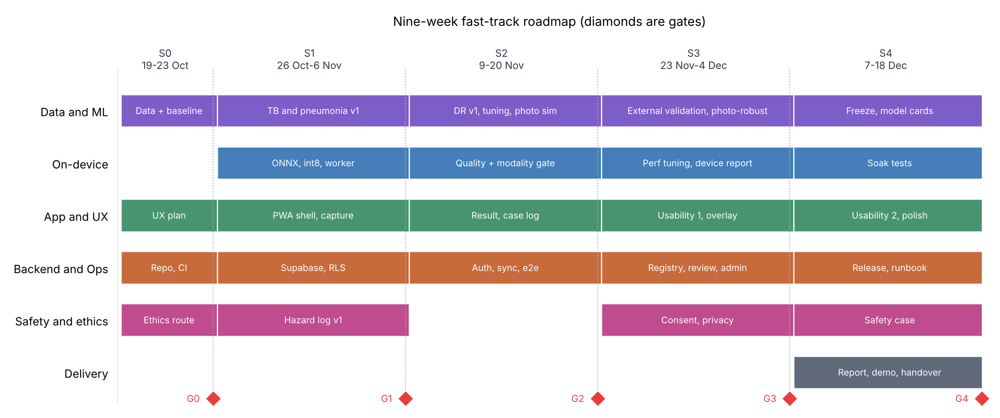
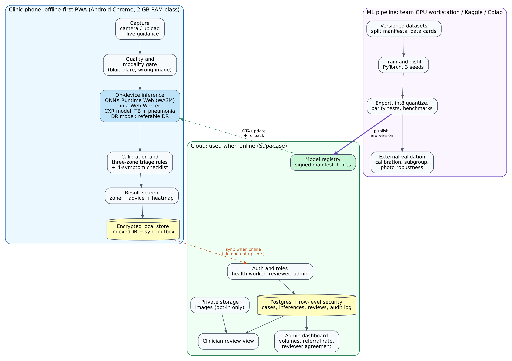

> Baseline v1.0 (15 Oct 2026). Do not edit in place. Change requirements through an ADR in docs/adr/ and record the change in the change log of docs/planning/04_Team_Rules_and_Requirements.md.

# 1. Document Control

| Item | Detail |
|---------------------|----------------------------------------------------------------|
| Document | Technical Requirements Document (TRD), version 1.0 (draft for team sign-off) |
| Working title | TriageLens (placeholder; rename freely) |
| Course | Building Intelligent Systems (capstone) |
| Team | Kweku (team lead), Chelsea, Nana Yaw, Micheal |
| Document owner | Kweku |
| Date | 15 October 2026 |
| Companion documents | 02 Product Backlog, 03 Sprint Plan, 04 Team Rules and Requirements |
| Status | Draft. Becomes baseline when all four members sign the Team Rules document. |

**How requirements are written.** Requirements use IDs: FR (functional), NFR (non-functional), ML (machine learning), ADR (architecture decision), R (risk), H (hazard). The words MUST, SHOULD and COULD follow the MoSCoW scale used in the backlog: MUST items define the minimum viable product; SHOULD items are planned but cut first; COULD items are stretch ideas.

**Terms used without jargon.** "Triage" means sorting patients by who needs a specialist or a lab test first. "On-device" means the AI runs on the phone itself, with no internet. "Sensitivity" means the share of sick people the tool catches. "Specificity" means the share of healthy people it correctly clears. A glossary is in Appendix D.

# 2. Executive Summary

**The problem.** Ghana and many African countries have very few radiologists and eye specialists, and most are in big cities. District clinics often take chest X-rays or retinal photos but have nobody nearby to read them quickly. Tuberculosis (TB), pneumonia and diabetic retinopathy (DR, an eye disease caused by diabetes) are all treatable when found early and dangerous when missed.

**The product.** TriageLens is a phone app for trained health workers. The worker photographs a chest X-ray (film on a light box, or a screen) or uploads a digital image, or captures a retinal image from a handheld camera. The app checks the image quality, runs AI models directly on the phone, and shows one of three plain results: **Refer now**, **Unsure: retake or refer**, or **Low risk**. It works with no internet, runs on a low-end Android phone, and syncs to the cloud when a connection is available. A remote clinician can review results and give feedback.

**The ambition (top tier) and the plan (fast track).** The team is aiming at the most advanced version: three conditions, three safety layers (image gate, calibrated uncertainty, clinician review), phone-photo robustness, external validation and a path to local clinical validation. To deliver in nine weeks without overworking anyone, the plan builds a **thin working slice first** (end of Sprint 1), widens it (Sprints 2 and 3) and hardens it (Sprint 4). Items that need outside approvals (clinic data, ethics) run in parallel and are treated as stretch goals so they cannot block delivery.

**What makes it different from a standard capstone.**

1. It is designed for **real clinic conditions**: low-end phones, no internet, glare on film, hurried users.
2. It is **honest about uncertainty**: it can say "unsure" and "retake", never "you are fine".
3. It **measures what usually goes unmeasured**: performance on phone photos of X-rays, on a second dataset from a different country, and on a cheap phone.

**Size of the work.** 144 planned points (about 360 hours) across 63 stories in five sprints, with 50 further points of stretch ideas in the icebox.

# 3. Problem, Goals and Success Metrics

## 3.1 Goals

1. **G1. Triage support.** Give a first-line health worker a fast, reliable "who needs referral first" signal for TB, pneumonia and DR.
2. **G2. Works where the clinics are.** Run fully offline on a low-end Android phone with a 2 GB RAM class device.
3. **G3. Safe by design.** Prefer "refer" or "retake" over a false reassurance; make limits visible.
4. **G4. Evidence, not claims.** Report accuracy with confidence intervals on data the models never saw, on phone photos, and on a cheap phone.
5. **G5. Deliverable in nine weeks** by a four-person team without overwork.

## 3.2 Non-Goals

- Replacing radiologists, eye specialists or laboratory confirmation.
- Diagnosing individual patients or recommending treatment.
- Obtaining medical-device approval (the capstone delivers a research prototype with a safety case).
- Children's X-rays (the TB and pneumonia models are for people aged 15 and over in this version).
- Electronic medical record integration, payments or billing.

## 3.3 Intended Use (frozen in Sprint 0, story E0-04)

> TriageLens is a research prototype for **trained health workers** at primary-care and district facilities. It analyses a chest X-ray (people aged 15 and over) or a retinal image (adults with diabetes) and **suggests** a screening result and referral advice. It **does not diagnose**, does not replace laboratory or clinician confirmation, and must not be used for emergencies or as the only basis for a decision. It is not a certified medical device.

## 3.4 Success Metrics

The **target** is what we aim for. The **floor** is the minimum acceptable; a result below the floor triggers a recorded decision and fix plan. Results are **always reported honestly**, including when they miss the target.

| Area | Metric | Target | Floor | Measured on |
|------------------|----------------------------------|-------------------|-------------------|---------------------------|
| TB screening | AUROC on external chest X-ray sets | at least 0.90 | at least 0.80 | Montgomery, India set (external) |
| TB screening | Sensitivity at the chosen threshold, with specificity at least 70% | at least 90% | at least 85% | Same; follows the WHO triage target |
| Pneumonia | AUROC on external set | at least 0.85 | at least 0.75 | VinDr-CXR (external) |
| DR | Referable-DR sensitivity with specificity at least 80% | at least 85% | at least 80% | Messidor-2, IDRiD, mBRSET |
| DR | AUROC on external sets | at least 0.93 | at least 0.85 | Same |
| Phone photos | AUROC drop on real phone photos vs clean images | at most 0.05 | at most 0.10 | Team photo set (300+), CheXphoto |
| Compression | AUROC drop from int8 vs full precision | at most 0.015 | at most 0.03 | Internal test set |
| Calibration | Expected calibration error after calibration | at most 0.05 | at most 0.10 | Validation and external sets |
| Image gate | Share of invalid images rejected | at least 95% | at least 90% | Mixed non-medical and wrong-type set |
| Speed | p95 inference time per image, reference phone | at most 2.5 s | at most 4 s | Benchmark harness |
| Size | Each model, int8 | at most 15 MB | at most 25 MB | Build artifact |
| Offline | Core flow works with no internet | 100% | 100% | Automated offline tests |
| Usability | System Usability Scale (SUS) | at least 75 | at least 68 | 5+ health workers, 2 rounds |
| Usability | Task success on first screening | at least 90% | at least 80% | Same |
| Usability | Median time to first result | at most 90 s | at most 150 s | Same |
| Delivery | Must points delivered on schedule | at least 90% | at least 80% | Sprint reports |

# 4. Scope and Fast-Track Strategy

## 4.1 Top-Tier Vision vs What We Build in Nine Weeks

| Capability | Top-tier vision | Built in the nine weeks | Stretch or later |
|--------------------|----------------------------|------------------------------------------|------------------------------|
| Conditions | TB, pneumonia, DR and more | TB and pneumonia (chest X-ray), referable DR (retinal image) | Lung ultrasound pneumonia (E15-09) |
| Image input | Phone photos, digital files, DICOM, handheld retinal camera | Phone photos and image files (JPEG, PNG) | DICOM files (E15-01) |
| Where AI runs | On the phone, offline | On the phone, offline, as an installable web app (PWA) | Native Android comparison (E15-07) |
| Safety layers | Image gate, uncertainty, clinician review | All three | Clinician review is Should |
| Explanation | Heatmap | Heatmap (Should) | Lung-field cropping (E15-03) |
| Phone-photo robustness | Trained and tested on real photos | Simulated plus real photo test set | Larger real photo set |
| Validation | Local clinical validation | External public sets, own photo set, usability tests | Local retrospective study (E15-02, needs approval) |
| Learning from use | Feedback loop and retraining | Reviewer feedback and agreement tracking | Retraining from feedback |
| Languages | English, Twi, Ga, Ewe | English with a localization framework | Local-language strings (E15-05) |
| Agentic features | Assistants for evaluation reports and referral letters | None in the core product | Evaluation reporter (E15-06), referral drafting (E15-08) |
| Training approach | Federated, privacy-preserving | Central training on public data | Federated simulation (E15-10) |
| Regulation | Ghana FDA pathway | Research prototype with safety case | Future |

## 4.2 Fast-Track Principles

1. **Thin slice first.** By the end of Sprint 1 a real phone must go from camera to a TB and pneumonia result with no internet. Everything else widens that slice.
2. **Must first, Should second, Could last.** The cut order is written down in advance (backlog section 2.3).
3. **Boring, proven technology.** Pre-trained small networks, ONNX Runtime, Supabase, a standard web stack. No custom infrastructure.
4. **Time-boxed spikes.** An unknown gets one day. Then decide and write a one-page decision record (ADR).
5. **Parallel tracks for things we cannot control.** Ethics approval, dataset access and clinic partnerships start in Sprint 0 and are never on the critical path.
6. **Swap, never add.** New scope displaces equal scope.
7. **Protect the people.** 83 percent planned load, no weekend work expected, work-in-progress limits, and a workload rating at every retrospective.

## 4.3 Assumptions

| ID | Assumption | If wrong |
|-----|--------------------------------------------------------------------|------------------------------------------|
| A1 | Final delivery is Friday 18 December 2026; work starts Monday 19 October. | Keep sprint order; cut Should items; adjust gate dates. |
| A2 | Each person has about 12 hours per week and plans 10. | Recalculate capacity after Sprint 0. |
| A3 | Free GPU access (Kaggle, Colab or a university machine) gives about 80 GPU-hours in total. | Use smaller backbones and fewer seeds. |
| A4 | A budget Android phone (2 GB RAM, Chrome) can be borrowed or bought as the reference device. | Use the weakest phone available and record its specs. |
| A5 | Public datasets listed in Appendix A can be accessed for research. | Fall back to fully open sets; start requests in Sprint 0. |
| A6 | A health worker or nurse can be reached for interviews and usability tests. | Use nursing students or community health volunteers. |
| A7 | Cloud costs stay under about USD 50 a month using free tiers. | Cut the dashboard; self-host later. |
| A8 | Local clinic data and an ethics approval will not arrive in time to be required. | If they do, pull E15-02 in. |
| A9 | The team can use Android Chrome as the primary target; iOS is best effort. | Keep a plain-web fallback. |
| A10 | Team members are willing to learn and to pair across skills. | See the learning plan in the Team Rules. |

## 4.4 Constraints

- **Time:** about nine weeks of part-time work by four students.
- **Devices:** low-end Android phones with weak processors, 2 GB RAM and little storage.
- **Connectivity:** intermittent or absent; data may be expensive.
- **Data:** public datasets come mostly from other countries. No local patient data is guaranteed.
- **Privacy and ethics:** health data is sensitive; any human-subject work needs the right approval.
- **Budget:** free tiers and personal hardware.

## 4.5 Out of Scope

Treatment advice; any "diagnosis" wording; children's X-rays; teleradiology reporting; integration with hospital information systems; payment; running large language models on the phone; regulatory submission.

## 4.6 Open Decisions for the Team (answer in Sprint 0)

| ID | Decision | Default if nobody answers by 23 Oct |
|-----|----------------------------------------------------|--------------------------------------------|
| D1 | What is the real submission and demo date? | 18 December 2026. |
| D2 | Which phone is the reference device? | Cheapest Android phone a team member owns. |
| D3 | Do we have a clinic or nurse contact for interviews? | Kweku asks through personal network (E12-01). |
| D4 | Which GPU source do we use? | Kaggle plus Colab; Chelsea owns the account list. |
| D5 | Final product name. | TriageLens. |
| D6 | Is any member away for exams or assignments in the nine weeks? | Micheal collects dates in Sprint 0 and updates the plan. |

# 5. Project Breakdown (Work Breakdown Structure)

The project is split into 15 workstreams (epics). Each has a clear deliverable and a definition of finished. The numbers below come from the backlog.

## 5.1 Workstreams, Deliverables and Size

| Epic | Workstream | Points | Est. hours | Sprints |
|------|----------------------------------------------|---------|-----------|----------------|
| E0 | Project Setup and Governance | 7 | 18 | S0, S1, S4 |
| E1 | Data Acquisition and Preparation | 9 | 22 | S0, S1, S2 |
| E2 | Chest X-ray Models (TB, Pneumonia) | 13 | 32 | S0, S1, S2, S4 |
| E3 | Retinal Model (Diabetic Retinopathy) | 5 | 12 | S1, S2 |
| E4 | Image Quality and Modality Gate | 8 | 20 | S0, S1, S2 |
| E5 | Compression and On-Device Inference | 8 | 20 | S1, S3 |
| E6 | Calibration, Uncertainty and Explainability | 7 | 18 | S2, S3 |
| E7 | Phone-Photo Robustness | 5 | 12 | S2, S3 |
| E8 | Mobile App (PWA) and UX | 26 | 65 | S0, S1, S2, S3, S4 |
| E9 | Backend, Auth and Sync | 11 | 28 | S1, S2, S3 |
| E10 | Clinician Review and Admin | 6 | 15 | S3 |
| E11 | Validation and Benchmarking | 10 | 25 | S3, S4 |
| E12 | Ethics, Safety and Compliance | 6 | 15 | S0, S1, S3, S4 |
| E13 | DevOps, CI/CD and QA | 8 | 20 | S1, S2, S3, S4 |
| E14 | Capstone Delivery | 15 | 38 | S4 |
|  | **Total** | 144 | 360 |  |

| Epic | What it delivers | Finished when |
|------|----------------------------------------------------|----------------------------------------------------|
| E0 Setup and governance | Repo, CI, board, working agreement, intended-use statement, risk register | All four can ship a pull request; scope is written down |
| E1 Data | Versioned datasets, licence register, data cards, patient-level splits, photo-capture protocol and photo test set | Splits have no leakage; 300+ real phone photos exist |
| E2 Chest X-ray models | TB and pneumonia models, multi-task decision, distilled student | Frozen models meet or honestly miss targets with CIs |
| E3 Retinal model | DR data pipeline and model (5-grade plus referable flag) | External AUROC and kappa reported |
| E4 Image gate | Quality checks (blur, glare, exposure, framing) and modality gate | Bad images are rejected with a clear reason |
| E5 On-device inference | ONNX export, int8 quantization, parity tests, device benchmark harness, performance tuning | p95 inference and memory fit the budget on the reference phone |
| E6 Calibration and explanation | Temperature scaling, three-zone thresholds, heatmaps, subgroup analysis | Zones meet the sensitivity target; heatmap sanity check passes |
| E7 Phone-photo robustness | Photo simulation library, robust retraining, ablation | Table shows clean vs simulated vs real photo results |
| E8 App and UX | Installable offline PWA, capture, result screen, case log, overlay, localization, two usability rounds | SUS at least 75 on the second round |
| E9 Backend, auth and sync | Supabase schema with row-level security, auth and roles, offline sync, model registry | Offline-queued cases sync with no loss or duplicates |
| E10 Review and admin | Clinician review and feedback, admin dashboard | Reviewers can confirm or correct results; dashboard has no identifiers |
| E11 Validation and benchmarking | External validation, device report, model cards, regression and soak tests | Locked sets run once; 72-hour soak passes |
| E12 Ethics, safety and compliance | Ethics route, hazard log, consent and privacy controls, safety case | Hazards closed or accepted; consent works end to end |
| E13 DevOps and QA | CI, preview deploys, offline end-to-end tests, budgets, release pipeline, backups | One-command release and rollback |
| E14 Delivery | Report, runbook, demo video, user guide, README | Newcomer can run the system from the docs |

## 5.2 Milestones and Gates

{ width=100% }

| Gate | Date | Meaning |
|------|--------------|----------------------------------------------------------------|
| G0 | 23 Oct | Foundations: repo, CI, data, baseline model, plan |
| G1 | 6 Nov | Thin slice: offline TB and pneumonia result on a real phone |
| G2 | 20 Nov | Core product: three conditions, safe outputs, sync and auth |
| G3 | 3 Dec | Proven: external validation, device report, usability round 1, feature freeze |
| G4 | 18 Dec | Delivered: frozen models, report, demo, handover |

## 5.3 Effort and Capacity

| Sprint | Dates | Working days | Points | Kweku | Chelsea | Nana Yaw | Micheal |
|----------|------------------------------|---------|--------|--------|--------|---------|--------|
| Sprint 0 | Mon 19 Oct to Fri 23 Oct 2026 | 5 | 16 | 4 | 4 | 4 | 4 |
| Sprint 1 | Mon 26 Oct to Fri 6 Nov 2026 | 10 | 32 | 8 | 8 | 8 | 8 |
| Sprint 2 | Mon 9 Nov to Fri 20 Nov 2026 | 10 | 32 | 8 | 8 | 8 | 8 |
| Sprint 3 | Mon 23 Nov to Fri 4 Dec 2026 | 9 | 32 | 8 | 8 | 8 | 8 |
| Sprint 4 | Mon 7 Dec to Fri 18 Dec 2026 | 10 | 32 | 8 | 8 | 8 | 8 |
| **Total** |  |  | 144 | 36 | 36 | 36 | 36 |

Each person plans at most 8 points (about 20 hours) per two-week sprint. The plan holds a deliberate buffer of about 15 to 20 percent. Full detail is in the Sprint Plan.

# 6. Users, Context and Key Journeys

## 6.1 Users

| User | Who they are | What they need | What matters most |
|----------------|------------------------------------------|-----------------------------------------|---------------------------------|
| Health worker (primary) | Community health nurse or clinic staff at a district facility; trained to take images but not to read them | A fast, clear "refer or not" signal and what to do next | Speed, simplicity, works offline, hard to misread |
| Clinician reviewer | Doctor, radiologist or eye specialist, often remote | See flagged cases, confirm or correct results | Fast review, little noise, can disagree easily |
| Programme admin | District or programme officer | See volumes, referral rates and whether reviewers agree with the AI | No patient identifiers; trends |
| Maintainer | The student team and later maintainers | Safe model updates, clear logs, reproducible builds | Version control and rollback |

## 6.2 Operating Context

| Factor | Reality to design for |
|----------------------|--------------------------------------------------------------------|
| Phone | Low-end Android, 2 GB RAM, small screen, cracked screens, little free storage |
| Internet | Off for days at a time; data is expensive |
| Power | Interruptions; battery matters |
| Light | Bright sunlight outdoors; glare on screens and film |
| Users | Busy, interrupted, varying digital comfort; reading level and language vary |
| Images | X-ray film on a light box, screens, sometimes digital files; fundus from a handheld camera |
| Patients | Adults and adolescents 15 and over for X-ray; adults with diabetes for retinal screening |

## 6.3 Key Journeys

**J1. Screening (happy path).** Worker opens the app, confirms age is 15 or over, captures the film, sees a green "good image" check, waits a few seconds, sees the result zone with advice and a heatmap, optionally ticks the four symptoms, saves the case.

**J2. Poor image.** Glare or blur is detected. The app says exactly why ("shiny spot on the right: tilt the phone"), and offers a retake. No result is shown for an image that fails the gate.

**J3. Unsure result.** The model is not confident, or the symptoms disagree with a low-risk result. The app shows amber: "Unsure. Retake the image, or refer."

**J4. Offline for days.** The worker screens many patients with no internet. Cases are stored on the phone, encrypted. When internet returns, they sync without duplicates.

**J5. Review.** A reviewer sees recent cases, opens one, confirms or corrects the AI result and leaves a note. The agreement rate updates for the admin.


# 7. Functional Requirements

## 7.1 Requirements Table

| ID | Requirement | Priority | Acceptance criteria |
|-------|--------------------------------------------------|----------|--------------------------------------------------|
| FR-01 | **Image intake.** The app accepts an image from the camera or from files and gallery (JPEG, PNG, WebP; resized on the device). It removes EXIF and location data. | MUST | Both paths reach the quality gate; stored copy has no EXIF or GPS. |
| FR-02 | **Image-type check.** The app decides whether the image looks like a chest X-ray, a retinal image or something else, and refuses anything else. | MUST | At least 95% of non-medical and wrong-type images are rejected on the mixed test set. |
| FR-03 | **Quality gate.** The app checks blur, glare, exposure and framing and gives a specific retake reason. No result is shown for a failed image. | MUST | Runs in under 300 ms on the reference phone; every rejection shows one reason from the approved list. |
| FR-04 | **On-device inference.** The chest X-ray model gives TB and pneumonia scores; the retinal model gives a referable-DR score. All run with no network. | MUST | Airplane-mode test passes; output matches the PyTorch reference within tolerance (parity test). |
| FR-05 | **Triage result.** The app shows one zone per case (Refer now, Unsure, Low risk), a status per condition, plain-language advice, the intended-use reminder and the model version. An optional four-symptom checklist can raise a zone but never lower it. The app never shows "negative", "healthy" or "no disease". | MUST | Zone shown with colour, icon and text; thresholds come from the frozen calibration file; wording passes a checklist review. |
| FR-06 | **Visual explanation.** The app can overlay a heatmap showing where the model looked. | SHOULD | Renders in under 200 ms; passes a randomized-weights sanity check. |
| FR-07 | **Case record.** Each case gets a pseudonymous ID, age band, optional sex, symptoms, result, model version, time and notes. No names or phone numbers. The record is created at capture so a crash does not lose it. History can be browsed and searched by ID. | MUST | Cases survive app restart and phone reboot; 500 cases open without slowdown. |
| FR-08 | **Offline-first sync.** Cases queue locally and upload when online with retries. Uploads are safe to repeat. The app shows sync status. | MUST | 50 cases created offline sync with no duplicates or losses. |
| FR-09 | **Accounts and roles.** Users sign in. Roles: health worker, reviewer, admin. After sign-in the app unlocks offline with a PIN for up to 14 days. | MUST | Roles enforced by the database; PIN locks after 5 wrong tries; local cases are kept after the offline window ends. |
| FR-10 | **Clinician review.** A reviewer can open a case, confirm or correct the AI result and add a note. | SHOULD | Review stored and visible to the health worker; agreement rate calculated. |
| FR-11 | **Admin dashboard.** Admins see volumes, referral rate and reviewer agreement by facility and week, with no patient identifiers. | SHOULD | Dashboard matches database counts. |
| FR-12 | **Model management.** Models and thresholds are versioned and signed. The app downloads new versions in the background and can roll back. Every result shows the model version. | SHOULD (version display MUST) | A tampered model file is rejected; rollback restores the previous version. |
| FR-13 | **Consent and privacy.** Consent is recorded before any upload. Images stay on the phone unless the patient agrees to upload. Deletion on request works. | MUST | Upload blocked without consent; deletion request removes the case and images. |
| FR-14 | **Plain-language and localization.** Strings are externalized, reading level is grade 8 or lower and key steps use icons. | SHOULD | No hard-coded strings; usability testers understand the three zones. |
| FR-15 | **Referral slip.** The app can create a printable or shareable referral slip offline. | COULD | Stretch item E15-04. |
| FR-16 | **Live capture guidance.** While the camera is open, the app shows a frame, tilt and glare hints and can auto-capture when the image is steady and good. | SHOULD | Fewer retakes per good capture than without the overlay. |
| FR-17 | **Audit log.** The server records sign-ins, case access, reviews, deletions and model changes. | MUST | Each listed event produces one audit row with actor and time. |

## 7.2 Triage Decision Logic

Each condition has two thresholds chosen on validation data (never on test data): a **screen-out** threshold set so the model catches at least 90 percent of true cases, and a **refer** threshold set where the model is confident enough that false alarms are limited.

| Zone | Rule (per condition) | Message in plain language | Action shown |
|--------------|--------------------------------------|--------------------------------------------------|----------------------------------|
| **Refer now** (red) | Score at or above the refer threshold | TB: "High risk on this scan. Refer for a TB confirmation test." Pneumonia: "Possible pneumonia. Assess the patient and refer per protocol." DR: "Possible serious eye disease from diabetes. Refer to an eye clinic." | Refer; show heatmap |
| **Unsure** (amber) | Score between thresholds, or the image is borderline, or symptoms contradict a low score | "Not sure. Retake the image, or refer." | Retake or refer |
| **Low risk** (green) | Score at or below the screen-out threshold, image quality good, no symptoms raising the zone | "Low risk on this scan. This does not rule out disease. If symptoms continue, test or refer." | Follow normal care |

Case-level zone is the **worst** of the condition zones. Failed quality checks never produce a zone. Uncertainty always moves toward "refer" or "retake".

## 7.3 Wording and Display Rules (Safety-Relevant)

- Allowed: "high risk", "low risk", "refer", "not sure", "retake".
- Not allowed: "diagnosis", "positive", "negative", "healthy", "you do not have".
- Every result screen carries a short reminder: "Screening support only. A clinician decides."
- Colour is never the only signal: every zone also has an icon and text.
- Raw probabilities are shown only in a "details" panel for reviewers.

## 7.4 Capture Protocol (X-ray film or screen photographed by phone)

The full protocol is in Appendix C. In short: uniform light box or screen at medium brightness, dark room, phone parallel to the film at 30 to 40 cm, no flash, whole film in frame with a small border, hold steady, take two shots.

# 8. Non-Functional Requirements

| ID | Requirement | Target | How it is verified |
|-----------------|----------------------------------------------------|----------------------------------|------------------------------|
| NFR-PERF-01 | p95 on-device inference per model | at most 2.5 s on the reference phone | Benchmark harness (E5-01) |
| NFR-PERF-02 | Capture to result, excluding user framing | at most 5 s p95 | Benchmark harness |
| NFR-PERF-03 | Quality gate | at most 300 ms | Benchmark harness |
| NFR-PERF-04 | Peak browser memory during inference | at most 350 MB | Device profiling |
| NFR-PERF-05 | App shell size (JavaScript and CSS, gzip) | at most 300 KB; launch after install at most 3 s | Lighthouse CI budget (E13-03) |
| NFR-PERF-06 | First install download (app plus models) | at most 45 MB | Build report |
| NFR-PERF-07 | UI responsiveness | No main-thread task over 50 ms during inference (heavy work in a Web Worker) | Performance trace |
| NFR-SIZE-01 | Each int8 model | at most 15 MB; total offline footprint at most 60 MB | Build artifact check |
| NFR-OFFL-01 | Core flow (capture, check, result, save) works with no network | 100% | Offline end-to-end tests (E13-02) |
| NFR-OFFL-02 | Local queue capacity | at least 500 cases | Test |
| NFR-REL-01 | No data loss on crash, kill or battery failure | 0 lost cases | Fault-injection tests |
| NFR-REL-02 | Sync is idempotent and resumable | No duplicates after repeats | Sync tests |
| NFR-REL-03 | Soak test | 72 hours with no crash | Soak run (E11-04) |
| NFR-REL-04 | Storage full or evicted | Warn the user; never silently drop cases | Test |
| NFR-USAB-01 | Taps from home to capture | at most 5 | Usability test |
| NFR-USAB-02 | Touch targets | at least 48 px; text contrast at least 4.5 to 1 (7 to 1 for zone messages, for sunlight) | Accessibility audit |
| NFR-USAB-03 | Zone display | Colour plus icon plus text | Design review |
| NFR-USAB-04 | Reading level | Grade 8 or lower | Readability check |
| NFR-USAB-05 | Accessibility | Meet WCAG 2.2 AA where practical | Audit |
| NFR-SEC-01 | Data in transit | TLS 1.2 or higher | Configuration check |
| NFR-SEC-02 | Images at rest on the phone | AES-GCM 256-bit; key derived from the user PIN with PBKDF2 (600,000 iterations or more, measured on the reference phone) | Code review and test |
| NFR-SEC-03 | Authorization | Row-level security on every table; least privilege | RLS tests (E9-01) |
| NFR-SEC-04 | Secrets and dependencies | No secrets in the repo; dependency and secret scanning in CI | CI (E13-03) |
| NFR-SEC-05 | Web hardening | Strict content security policy; no third-party scripts | Header check |
| NFR-SEC-06 | Model integrity | Models and thresholds are signed (ECDSA P-256) and verified before use | Tamper test |
| NFR-PRIV-01 | Data minimization | No names, phone numbers or national IDs; age band instead of birth date | Schema review |
| NFR-PRIV-02 | Images are not uploaded by default | Upload only with explicit consent | Test |
| NFR-PRIV-03 | Metadata removal | EXIF, GPS and any DICOM tags stripped | Test |
| NFR-PRIV-04 | Retention and deletion | Research retention 12 months by default; deletion within 30 days of request | Procedure check |
| NFR-SAFE-01 | Intended-use banner and forbidden wording | Always present; checklist review | Design review |
| NFR-SAFE-02 | Fail-safe behaviour | Uncertainty leads to refer or retake | Unit tests on triage rules |
| NFR-SAFE-03 | Traceability | Every result stores model version, threshold version and quality scores | Schema review |
| NFR-MAINT-01 | Code quality | Lint and type checks pass; at least 70% line coverage on triage rules, sync and quality gate | CI |
| NFR-MAINT-02 | Reproducible builds and experiments | One command rebuilds the app; experiments rerun from config and seed | Rebuild test |
| NFR-OBS-01 | Observability | Opt-in error and performance logs with no personal data; model version on every record | Review |
| NFR-COMP-01 | Compatibility | Android 8 or newer with Chrome 90 or newer; minimum screen 360 by 640; iOS Safari 16 or newer best effort | Device tests |
| NFR-LOC-01 | Localization-ready | All user-facing strings externalized | Lint rule |
| NFR-COST-01 | Cloud cost | At most USD 50 a month during the build | Billing review |

# 9. Machine Learning Requirements

## 9.1 Tasks

| Task | Input | Output | Population |
|-----------------|--------------------------------|--------------------------------------------------|-------------------------------|
| TB screening | Chest X-ray | TB risk score | People aged 15 and over |
| Pneumonia screening | Chest X-ray | Pneumonia risk score | People aged 15 and over |
| DR screening | Retinal (fundus) image | Grade 0 to 4 and referable-DR score (grade 2 or higher) | Adults with diabetes |
| Image gate | Any image | Chest X-ray, retinal, other medical, non-medical, unusable | Any |

## 9.2 Data Rules

| ID | Rule |
|----------|----------------------------------------------------------------------------|
| ML-DATA-01 | Every dataset has a data card (source, size, labels, known problems) and a licence entry before use. |
| ML-DATA-02 | Splits are made by **patient**, never by image. A fixed seed and a committed manifest define each split. |
| ML-DATA-03 | Exact and near-duplicate images are removed (hash and perceptual hash) and overlap between source datasets is checked before external sets are assigned. |
| ML-DATA-04 | External test sets are **locked**. They are not used for training, tuning or threshold choice, and are evaluated once per frozen model candidate. |
| ML-DATA-05 | Known-problem datasets (for example the paediatric Kermany set) are not used for training. |
| ML-DATA-06 | Large datasets are used as downsized, versioned copies (for example 20,000 EyePACS images) to fit the compute budget. |
| ML-DATA-07 | Datasets are never redistributed; copies stay on team-controlled storage. |

Dataset roles are in Appendix A.

## 9.3 Model Design

| Item | Decision |
|----------------------|--------------------------------------------------------------------|
| Backbone candidates | MobileNetV3-Large (about 5.4 million parameters) and EfficientNet-Lite0 (about 4.7 million). A one-week bake-off in Sprint 1 picks by external AUROC, latency on the reference phone and compatibility with heatmaps (ADR-3). |
| Head | Global average pooling followed by one linear layer, so a class activation map can be computed from the last feature map (ADR-9). |
| Chest X-ray model | One network with two outputs (TB and pneumonia) trained with a **masked loss**, because no dataset has both labels. If it is worse than two separate models by more than 0.02 AUROC, use two models (ADR-4). |
| Retinal model | Separate network; ordinal (rank-consistent) output for grades 0 to 4; referable-DR score derived from it. |
| Gate model | Very small network (at most 3 MB) trained on real X-rays, retinal images, other medical images, non-medical images and synthetic corruptions. |
| Input sizes | Chest X-ray 320 by 320; retinal 384 by 384 (up to 512 only if the latency budget allows). Gate 224 by 224. |
| Preprocessing | X-ray: grayscale copied to three channels, resize with padding, optional contrast limiting. Retinal: crop black borders, resize, optional local contrast. Same code path in Python and in the browser. |
| Teacher-student | If time allows, a larger teacher (for example a bigger EfficientNet or a published chest X-ray network) trains the small student by distillation (E2-04). |

## 9.4 Training Recipe

Requirement group **ML-TRAIN** covers sections 9.3 to 9.5.

| Item | Setting |
|-------------------|--------------------------------------------------------------------|
| Start | ImageNet-pretrained weights; fine-tune all layers after a short head-only warm-up |
| Optimizer | AdamW, cosine learning-rate schedule, mixed precision, early stopping on validation AUROC |
| Loss | Binary cross-entropy with class weights or focal loss; masked for missing labels; label smoothing |
| Augmentation | Brightness and contrast, small rotation (up to 10 degrees), scale, noise, JPEG compression, and the phone-photo simulation (glare, tilt, moire, blur, uneven light). No horizontal flip for chest X-rays. |
| Seeds | Three seeds per final configuration; report mean and spread |
| Tracking | Every run logs config, seed, data manifest hash, code commit and metrics |
| Compute | About 80 GPU-hours in total (assumption A3); checkpoint often |

## 9.5 Compression and Export

1. Export to ONNX with a fixed input size.
2. Static int8 quantization with a calibration set of about 500 images from the validation split. Compare the two ONNX quantization formats (QOperator and QDQ) for speed in the browser.
3. Verify parity: browser output must match the PyTorch reference within tolerance on a fixed image set (runs in CI).
4. Verify accuracy: int8 AUROC within 0.015 of full precision (floor 0.03). If not, keep full precision for that model if it still fits the size budget.
5. Record size, latency and memory on the reference phone.

## 9.6 Calibration and Thresholds

| ID | Requirement |
|-------------|------------------------------------------------------------------------|
| ML-CALIB-01 | Apply temperature scaling on the validation split; report expected calibration error and reliability plots. |
| ML-CALIB-02 | Choose the screen-out threshold so validation sensitivity is at least 90 percent (TB) or the DR target; choose the refer threshold at a high-specificity point. |
| ML-CALIB-03 | Thresholds and temperatures live in a signed, versioned file, not in code. |
| ML-CALIB-04 | Report selective-prediction curves (how accuracy improves as unsure cases are sent for review) and the share of cases that land in "Unsure". |

## 9.7 Robustness to Phone Photos

| ID | Requirement |
|-------------|------------------------------------------------------------------------|
| ML-ROBUST-01 | Build a simulation library for glare, tilt, moire, blur, uneven lighting, compression and cropping, with unit tests. |
| ML-ROBUST-02 | Capture a real test set of 300 or more phone photos of displayed or printed X-rays on at least two phones (E1-05). |
| ML-ROBUST-03 | Run an ablation: train on clean images only, on clean plus simulated, and evaluate on clean, simulated and real photos. |
| ML-ROBUST-04 | Also evaluate on CheXphoto (a public set of phone photos and transformations of chest X-rays). |
| ML-ROBUST-05 | Report the AUROC drop on real photos; target at most 0.05. |

## 9.8 Evaluation Protocol

| ID | Requirement |
|-------------|------------------------------------------------------------------------|
| ML-EVAL-01 | Metrics: AUROC, area under precision-recall, sensitivity and specificity at the chosen thresholds, positive and negative predictive value at assumed prevalences of 1, 5 and 10 percent, calibration error. |
| ML-EVAL-02 | 95 percent confidence intervals by bootstrap (1,000 resamples); compare models with the DeLong test for AUROC. |
| ML-EVAL-03 | Report internal test, external test, phone-photo test and on-device (int8) results side by side. |
| ML-EVAL-04 | Review the 20 worst failures per model and categorize them (label error, image quality, shortcut, true miss). |
| ML-EVAL-05 | Follow a recognized reporting checklist (TRIPOD+AI style) in the report. |
| ML-EVAL-06 | Small external sets (for example Montgomery has about 138 images) give wide intervals. Report them as they are and do not over-claim. |

## 9.9 Fairness and Subgroups

Report metrics by sex, age band, source site and image type wherever the data carries these. State clearly which groups are missing (African patient data is scarce in public sets). Flag any subgroup where sensitivity is more than 10 points below the overall figure.

## 9.10 Model Documentation and Versioning

- One **model card** per model: intended use, data, metrics with intervals, limits, known failure modes, ethical considerations, version and hash.
- Version names such as `cxr-1.0.0` and `dr-1.0.0`. A manifest lists file hash, thresholds version, minimum app version and signature.
- Frozen models are immutable. Any change is a new version with a full re-run of validation.

Manifest example:

```json
{
  "model": "cxr-tb-pneu",
  "version": "1.0.0",
  "file": "cxr-tb-pneu-1.0.0.int8.onnx",
  "sha256": "<hash>",
  "input": {"shape": [1, 3, 320, 320], "mean": [0.485, 0.456, 0.406], "std": [0.229, 0.224, 0.225]},
  "outputs": ["tb_logit", "pneumonia_logit", "features"],
  "calibration": {"version": "2026-12-08", "temperature": {"tb": 1.0, "pneumonia": 1.0}},
  "thresholds": {"tb": {"screen_out": 0.0, "refer": 0.0}, "pneumonia": {"screen_out": 0.0, "refer": 0.0}},
  "min_app_version": "1.0.0",
  "signature": "<ECDSA P-256 signature>"
}
```

(The zeros are placeholders; real values come from the validation split.)

## 9.11 Monitoring and Retraining

There is no automatic retraining. After release, the team tracks reviewer agreement, the share of "Unsure" results, the quality-fail rate and simple input statistics to spot drift. Any new model follows the same pipeline: train, validate, freeze, sign, release.

# 10. System Architecture

## 10.1 Overview

{ width=88% }

The phone does the screening alone. The cloud is optional and used for sync, review, dashboards and model updates. The ML pipeline lives on the team's training machines.

## 10.2 Components

| Component | Responsibility | Runs on |
|------------------------|--------------------------------------------------|---------------------------|
| Capture and guidance | Camera, file input, live frame, tilt and glare hints, EXIF removal | Phone (main thread, light) |
| Quality and modality gate | Heuristic checks plus a small gate model; produce a retake reason | Phone (worker) |
| Inference worker | Loads ONNX models from the cache, runs inference with ONNX Runtime Web (WebAssembly) | Phone (Web Worker) |
| Triage engine | Applies calibration, thresholds, symptoms and age gate; produces the zone | Phone |
| Result UI | Zone, advice, heatmap, details panel | Phone |
| Local store | Encrypted IndexedDB, sync outbox, cached models | Phone |
| Sync client | Idempotent upload with retry and backoff | Phone |
| Auth and roles | Sign-in, roles, session handling | Cloud (Supabase Auth) plus phone PIN |
| Database | Cases, inferences, reviews, consents, audit log, with row-level security | Cloud (Postgres) |
| Storage | Opt-in images in private buckets | Cloud |
| Review and admin views | Clinician review and dashboards | Cloud web (same app, role-gated) |
| Model registry | Signed manifests and model files | Cloud (storage and CDN) |
| ML pipeline | Data, training, export, validation, benchmarks | Team GPU or notebooks |

## 10.3 Key Architecture Decisions

| ID | Decision | Options considered | Choice and why | Revisit if |
|-------|---------------------|----------------------------------|----------------------------------------------|-------------------------------|
| ADR-1 | App type | PWA, native Android, Flutter, React Native | **PWA first.** No app store, one codebase, fastest to build, offline via service worker, fits team skills. | p95 latency over 4 s on the reference phone: build the native comparison (E15-07). |
| ADR-2 | Inference runtime | ONNX Runtime Web (WebAssembly), TensorFlow.js, WebGPU, TFLite | **ONNX Runtime Web, WebAssembly with SIMD, threads when available.** Works on cheap phones without a GPU; supports int8. | Browser threads blocked; consider single-thread or native. |
| ADR-3 | Backbone | MobileNetV3-Large, EfficientNet-Lite0, MobileNetV2, larger nets | **Bake-off in Sprint 1.** Default MobileNetV3-Large with a plain pooling and linear head. | Latency or accuracy misses the budget. |
| ADR-4 | Chest X-ray outputs | One multi-task model, two models | **Try multi-task with masked loss first.** One forward pass saves time and memory. Fallback to two models if worse by more than 0.02 AUROC. | Label conflicts between datasets. |
| ADR-5 | Compression | Static int8, dynamic int8, float16, pruning | **Static int8 with a calibration set.** CPU-friendly. | Accuracy drop over 0.03. |
| ADR-6 | Backend | Supabase, custom FastAPI service | **Supabase** (Postgres, Auth, Storage, row-level security). Fast to stand up, free tier, built-in row-level security. | Data residency or regulation needs self-hosting. |
| ADR-7 | Offline storage | localStorage, IndexedDB, Cache API only | **IndexedDB (via a small wrapper) with an outbox**; images encrypted with WebCrypto. | Quota or eviction problems on target phones. |
| ADR-8 | Uncertainty | Calibrated scores with thresholds, MC dropout, deep ensembles | **Temperature scaling and two thresholds.** Cheap and explainable. | Ensembles fit the latency budget. |
| ADR-9 | Explanation | Class activation map, gradient-based maps | **Class activation map** from the final feature map; computed in the browser with no gradients. | Maps fail the sanity check. |
| ADR-10 | Image upload | Always, never, opt-in | **Opt-in with consent.** Results-only is the default. | Reviewers need images to work (use opt-in). |
| ADR-11 | Model signing | None, ECDSA P-256, Ed25519 | **ECDSA P-256** with WebCrypto: supported everywhere. | Ed25519 reaches universal support. |
| ADR-12 | Web framework | React with Vite, Next.js | **React, TypeScript and Vite** as a static PWA: smaller bundle, no server rendering needed. | A server-rendered admin app is needed. |

## 10.4 Technology Stack

| Layer | Choice |
|-------------------|--------------------------------------------------------------------|
| App | React 18, TypeScript, Vite, Workbox (service worker), a small IndexedDB wrapper, ONNX Runtime Web, Web Workers, WebCrypto, a small i18n library |
| Cloud | Supabase (Postgres, Auth, Storage, row-level security, a few edge functions for admin queries) |
| Hosting | Vercel (static PWA; response headers for cross-origin isolation); Supabase for data |
| ML | Python 3.11, PyTorch, a model library for backbones, scikit-learn, ONNX and ONNX Runtime (quantization), MLflow or Weights and Biases for tracking, data manifests with hashes (optional DVC) |
| Quality | Vitest, pytest, Playwright, Lighthouse CI, dependency and secret scanning |
| DevOps | GitHub monorepo, GitHub Actions, preview deploys, environment secrets |
| Design | Figma (design tokens), WCAG contrast checks |
| Collaboration | Team chat, shared board, shared drive for datasets (private) |

## 10.5 Client Design Details

- **Cross-origin isolation.** To use several CPU threads in WebAssembly, the site must be served with `Cross-Origin-Opener-Policy: same-origin` and `Cross-Origin-Embedder-Policy: require-corp`. This forbids third-party embeds, which suits the security rules. If threads are unavailable, fall back to one thread.
- **Workers.** Decoding, quality checks and inference run in Web Workers so the interface never freezes.
- **Memory guard.** On phones that report 2 GB of memory or less, use one thread, the smaller input size and one model at a time.
- **Storage.** Request persistent storage; keep stored images as compressed WebP (at most about 300 KB each); cap local storage (default 200 MB); delete images after confirmed upload only if the policy allows.
- **Service worker.** Precache the app shell; cache models after first load; offline fallback page; update only when idle.
- **iOS.** Background sync is limited on iOS, so also provide a visible "Sync now" button.
- **Camera.** Use the rear camera, request focus and exposure where supported, read device orientation (with permission) for the tilt hint.

## 10.6 Model Interface

| Model | Input | Outputs | Size target |
|-------------------|------------------------------------------|---------------------------------------------------|-------------|
| Chest X-ray (`cxr-tb-pneu`) | float32 [1, 3, 320, 320], normalized | TB logit, pneumonia logit, last feature map [1, C, h, w] | at most 15 MB |
| Retinal (`dr`) | float32 [1, 3, 384, 384], normalized | 4 ordinal logits (grade steps), feature map | at most 15 MB |
| Gate (`gate`) | float32 [1, 3, 224, 224], normalized | 5 class logits | at most 3 MB |

## 10.7 Data Model (Cloud)

| Table | Main fields | Notes |
|------------------|------------------------------------------------------------|--------------------------------|
| facilities | id, name, district, region | Scope for row-level security |
| profiles | user id, facility id, role, display name | Roles: health worker, reviewer, admin |
| cases | id (client-generated UUID), facility id, created by, created at, updated at, age band, sex (optional), symptoms, status, notes, client version | No names or phone numbers |
| inferences | id, case id, model name and version, thresholds version, outputs, zone, quality scores, latency, device info | Immutable |
| case_images | id, case id, storage path, sha256, consent id | Only with consent |
| consents | id, case id, scope, given at, withdrawn at | Required before upload |
| reviews | id, case id, reviewer id, decision, note, created at | One or more per case |
| model_versions | id, name, version, sha256, signature, status, released at | Registry |
| audit_log | id, actor, action, entity, entity id, time, meta | Append-only |

Row-level security: health workers see their own facility's cases; reviewers see cases with consent in their assigned facilities; admins see only aggregate views with no identifiers.

## 10.8 Sync Protocol

1. The phone creates each case with a client-generated UUID and writes it to the local store first.
2. The outbox holds pending changes in order. Each change carries the case id, a version number and a hash.
3. When online and signed in, the client sends changes in small batches with an idempotent upsert keyed by id and version. Repeating a batch changes nothing.
4. Inferences are immutable; notes follow last-write-wins by version; reviews are written only by reviewers and the server wins.
5. The server answers with accepted versions; the client clears those from the outbox. On failure it retries with backoff.
6. The UI always shows a count of unsynced cases and the time of last successful sync.

## 10.9 Environments

| Environment | Purpose | Data |
|-------------|-----------------------------------|--------------------------------------|
| Local | Development | Seeded fake data only |
| Preview | One per pull request | Seeded fake data |
| Staging | Release candidate and usability tests | Fake or consented test data |
| Production | The demo and any pilot | Real data only after ethics approval |

No real patient data is ever used in local or preview environments.


# 11. Security, Privacy and Compliance

## 11.1 Data Classification

| Class | Examples | Handling |
|--------------|----------------------------------------------|--------------------------------------------------|
| Restricted | Medical images, case records linked to a person | Encrypted on the phone; private buckets; row-level security; never shared in chat or email |
| Internal | Model files, thresholds, logs without personal data | Signed; access by team |
| Public | Published reports, public dataset names | No restriction |
| Test only | Fake or seeded data | May be used anywhere |

## 11.2 Access by Role

| Capability | Health worker | Reviewer | Admin | Maintainer |
|---------------------------------------|---------------|----------|-------|------------|
| Create and view own facility's cases | Yes | No | No | No |
| View consented cases for review | No | Yes | No | No |
| Add review | No | Yes | No | No |
| See aggregate dashboards | No | No | Yes | Yes |
| Manage users and facilities | No | No | Yes | No |
| Publish model versions | No | No | No | Yes |
| Read audit log | No | No | Yes | Yes |

## 11.3 Threat Summary (STRIDE)

| Threat type | Example | Mitigation |
|-------------------|------------------------------------------------|--------------------------------------------------|
| Spoofing | Someone uses a lost phone to open cases | PIN with lockout; encrypted images; remote sign-out of sessions |
| Tampering | A modified model or threshold file is installed | Signed manifests verified on the phone; hash checks; rollback |
| Repudiation | A reviewer denies changing a result | Append-only audit log with actor and time |
| Information disclosure | Images or records leak from the phone or database | Encryption at rest and in transit; row-level security; data minimization; no personal identifiers; private buckets with short-lived links |
| Denial of service | Sync endpoint flooded; storage full | Rate limits; local-first design so screening continues; storage warnings |
| Elevation of privilege | A health worker reads another facility's cases | Row-level security tests in CI; least-privilege roles |
| Supply chain | A malicious package | Lockfiles, dependency scanning, pinned versions, minimal dependencies |

## 11.4 Privacy and Ghana's Data Protection Law

- Health information is treated as **special personal data** under Ghana's Data Protection Act, 2012 (Act 843). The team will check with the Ashesi ethics committee and the Data Protection Commission what registration and consent wording are needed before any real patient data is handled. This document is not legal advice.
- **Data minimization:** no names, phone numbers or national IDs; age band instead of birth date; pseudonymous case IDs created by the app.
- **Consent first:** results-only is the default; images are uploaded only with recorded consent.
- **Retention:** research data kept 12 months by default; deletion within 30 days of a request.
- **Location:** cloud region and cross-border storage are recorded as a decision and reviewed with the ethics committee.
- **Breach plan:** any suspected leak is reported to the team lead at once; the team revokes keys, preserves logs, and follows the ethics committee's instructions.

# 12. Clinical Safety, Ethics and Regulatory Position

## 12.1 Human Oversight

The app supports a trained worker. It never closes a case on its own, always shows the intended-use reminder, and routes uncertainty to retake or referral. A clinician reviewer can correct any result.

## 12.2 Hazard Log (initial)

| ID | Hazard | Possible harm | Mitigation | Owner |
|-----|------------------------------------|--------------------------------------|--------------------------------------------------|-------|
| H1 | Missed TB or DR (false reassurance) | Delayed treatment, spread of infection | Sensitivity-first threshold; "does not rule out disease" wording; symptoms can raise the zone; clinician review; report sensitivity honestly | Kweku, Chelsea |
| H2 | Over-reliance on the tool (automation bias) | Worker skips clinical judgment | Reminder on every result; "Unsure" state; training note in the user guide; usability tests check understanding | Kweku |
| H3 | Wrong image type or poor image | Meaningless result | Modality gate and quality gate; no result on failure | Micheal |
| H4 | Domain shift (different machines, patients, film) | Lower accuracy than reported | External validation; phone-photo testing; clear limits; monitor "Unsure" and agreement rates; pilot only with approval | Chelsea |
| H5 | Used on children or out-of-scope patients | Wrong results | Age gate (15 and over); wording; guide | Kweku |
| H6 | Data breach | Loss of privacy | Minimization, encryption, row-level security, audit log, incident plan | Nana Yaw |
| H7 | Faulty or tampered model update | Silent errors | Signed manifests, staged release, rollback, parity tests | Nana Yaw, Chelsea |
| H8 | Colour-only signals misread | Wrong action | Colour plus icon plus text; contrast rules | Kweku |
| H9 | Lost cases (crash, storage evicted) | Missed follow-up | Case created at capture; persistent storage; storage warnings; sync status | Nana Yaw |
| H10 | Misuse as a diagnostic tool | Overclaiming | Intended-use banner; wording rules; claims review of report and demo | Kweku, Micheal |
| H11 | Shortcut learning (model reads markers or text, not disease) | Hidden failure | Dataset audit; photo and external testing; failure review; heatmap sanity checks | Chelsea |
| H12 | Biased performance across groups | Unequal care | Subgroup analysis; state missing groups; do not hide gaps | Chelsea |

The hazard log is created in Sprint 1 (E12-02) and closed or accepted in Sprint 4 (E12-04).

## 12.3 Ethics Pathway

1. **Sprint 0.** Identify the review route: the Ashesi Institutional Review Board for the capstone, and the Ghana Health Service ethics review if working with its facilities. Confirm exact requirements with the university.
2. **Usability tests with health workers.** Treat as human-subject work: written consent, no patient data, no recordings without permission, anonymized notes. Submit for approval or exemption before the first session.
3. **Public datasets only** for the core build. No real patient data enters the system without approval and a data-sharing agreement.
4. **Local validation (stretch).** A retrospective study at a partner clinic needs protocol approval, a data-sharing agreement and de-identification. It is tracked as E15-02 and cannot block delivery.

## 12.4 Regulatory Position

The capstone delivers a **research prototype**, not a marketed medical device. In Ghana, medical devices fall under the Food and Drugs Authority under the Public Health Act, 2012 (Act 851); software that gives diagnostic or treatment decisions can be regulated. The team will state a conservative intended use, keep a safety case, and note what a future regulatory path would need (clinical evaluation, quality management, post-market monitoring). Guidance used as a reference, not a certification claim: ISO 14971 (risk management for medical devices), IEC 62304 (medical software lifecycle) and the WHO guidance on ethics and governance of AI for health. Confirm current rules with the university before any pilot.

## 12.5 Claims Discipline

- Report only what was measured, on which data, with intervals.
- Always show negative and weak results next to strong ones.
- Do not say "diagnoses", "detects disease with X percent accuracy" without naming the dataset and threshold.
- The demo uses public or fake data only, and says so on screen.

# 13. Quality Assurance and Test Strategy

## 13.1 Test Levels

| Level | What it checks | Tools | When |
|----------------|--------------------------------------------------|-----------------------|------------------------------|
| Unit | Triage rules, thresholds, quality heuristics, sync logic, preprocessing | Vitest, pytest | Every pull request |
| Parity | Browser ONNX output equals the PyTorch reference on a fixed image set | pytest plus browser test | Every model change |
| Integration | App with local store, sync with a test database, row-level security | Playwright, SQL tests | Every pull request |
| End to end | Capture to result to save, **offline**; sync after reconnect; sign-in and PIN | Playwright with network disabled | Every pull request and nightly |
| Performance | Latency, memory, load time on the reference phone; bundle budgets | Benchmark harness, Lighthouse CI | Each sprint and on release |
| ML validation | Internal, external, phone-photo, subgroup, calibration | Evaluation scripts | Per frozen candidate |
| Security | Dependency, secret and header scans; role tests | CI scanners | Every pull request |
| Usability | Task success, time, SUS, think-aloud | Test script, notes | Sprint 3 and Sprint 4 |
| Soak and fault | 72-hour run; kill the app; fill storage; drop network mid-sync | Scripts, manual | Sprint 4 |
| Acceptance | Each Must story against its criteria | Checklist | At each gate |

## 13.2 ML-Specific Tests

- Split check: no patient or near-duplicate overlap across train, validation and test.
- Reproducibility: the same config and seed reproduce metrics within 0.01 AUROC.
- Preprocessing parity: Python and browser preprocessing give matching tensors on sample images.
- Triage rules: property tests that uncertainty never moves a result toward "Low risk".
- Wording lint: forbidden words (see 7.3) are blocked in the app strings.

## 13.3 Device Lab

Reference phone (cheapest Android available, 2 GB RAM) plus one mid-range phone. Record model, Android version, Chrome version, RAM and storage. Each benchmark reports cold start, model load time, p50 and p95 inference, peak memory and a rough battery estimate over 50 screenings.

## 13.4 Usability Test Plan

- **Participants:** at least 5 per round, from nurses, community health workers or nursing students. Written consent; no patient data.
- **Tasks:** install and open the app; screen one X-ray photo; retake a poor image; interpret an "Unsure" result; find a saved case; sync.
- **Measures:** task success, time to first result, errors, SUS, and what each person says the three zones mean.
- **Rounds:** round 1 in Sprint 3 (before the guidance overlay), round 2 in Sprint 4 (with the overlay, to compare retakes).

## 13.5 Definition of Done (summary)

A story is done when: code is merged after one review; tests pass in CI; acceptance criteria are shown to the project manager in a preview build; documentation or model card is updated; no new high-severity security finding; and the story meets the Definition of Done in the Team Rules.

# 14. DevOps, Delivery and Operations

## 14.1 Repository Layout

```
triagelens/
  apps/pwa/             React PWA (capture, results, case log, review, admin)
  packages/triage/      Triage rules and wording checks (shared, unit-tested)
  packages/quality/     Quality-gate heuristics
  ml/                   Data, training, export, evaluation (Python)
  ml/manifests/         Split manifests, data cards, model cards
  supabase/             Migrations, RLS policies, tests, seed data
  docs/                 TRD, ADRs, runbook, user guide
  .github/workflows/    CI and release pipelines
```

## 14.2 Pipelines

| Pipeline | Steps |
|-----------------|--------------------------------------------------------------------|
| Pull request | Lint, type-check, unit tests, build, bundle budget, security scan, offline end-to-end test, preview deploy |
| Model change | Export, quantize, parity test, accuracy check on a fixed set, size check, benchmark job (manual on the reference phone) |
| Release | Tag, build, sign model manifest, deploy to production, smoke test, one-command rollback |
| Nightly | Dependency scan, offline end-to-end suite, database backup check |

## 14.3 Operations

- **Backups:** daily database backup; restore tested once before the final gate.
- **Monitoring:** uptime check; opt-in client errors without personal data; model version on every record.
- **Runbook:** deploy, rollback, rotate keys, publish a model version, handle an incident (E14-02).
- **Branching:** short-lived branches from main; pull requests of at most about 400 lines; main is always releasable.

## 14.4 Estimated Running Cost (build period)

| Item | Estimate per month |
|---------------------------|------------------------------------|
| Supabase | Free tier, or about USD 25 if needed |
| Hosting (Vercel) | Free tier |
| GPU (Kaggle, Colab) | Free, or about USD 10 for extra Colab time |
| Domain (optional) | About USD 1 |
| **Total** | **At most about USD 36, under the USD 50 limit** |

# 15. Team, Roles and Capacity

## 15.1 Roles and Strengths

| Person | Skills | Main role in this project | Also covers |
|--------------|------------------------------------------------------|------------------------------------------------|------------------------------|
| **Kweku** (team lead) | Frontend, backend, UI/UX, HCI, product design, agentic work, AI engineering | Product owner; UX and HCI lead; frontend lead; schema and row-level security; DR data and calibration; ethics and safety lead | Second AI engineer (backup for Chelsea) |
| **Chelsea** | AI engineer | ML lead: data, models, evaluation, photo robustness, model cards | Ownership of the pipeline |
| **Nana Yaw** | DevOps, frontend, backend (small), testing | DevOps and MLOps lead; CI/CD; sync and auth; QA and device benchmarks | Release owner |
| **Micheal** | Frontend, AR/VR, project management, agent development | Project manager and scrum master; inference worker; capture guidance overlay; photo test set; admin dashboard; demo | Stretch agentic items |

Why this fit: the capture overlay (live frame, tilt and glare cues) is an AR-style task that suits Micheal; the sync and release work suits Nana Yaw's DevOps and testing strengths; Chelsea concentrates on the models; Kweku carries product, UX and safety and keeps his coding load at the same cap as everyone else.

## 15.2 Workload

Points per person per sprint are capped (4 in Sprint 0, 8 after). The leader is not exempt: leading, reviewing and unblocking are part of Kweku's load and are the reason his build work is held to 8 points like everyone else. Full tables are in the Backlog and Sprint Plan.

## 15.3 Learning Plan (Willing to Learn, Not Forced to Stretch)

| Person | Strength used | Learning goal (supported by a pair) |
|--------------|------------------------------------|--------------------------------------------------|
| Nana Yaw | CI/CD, testing | ONNX export and quantization basics, with Chelsea (E5-02, E5-03) |
| Micheal | Frontend, AR/VR, project management | Running ONNX in a Web Worker and simple image augmentation, with Chelsea and Kweku (E8-04, E7-01, E4-03) |
| Chelsea | ML engineering | PWA constraints and on-device testing, with Nana Yaw; model cards and calibration, with Kweku |
| Kweku | Product, UX, AI | Supabase row-level security and sync patterns, with Nana Yaw (E9-01, E9-02) |

Learning goals are optional stretch within the sprint load. Nobody is graded on them.

# 16. Risk Register

Likelihood and impact: L (low), M (medium), H (high).

| ID | Risk | L | I | Mitigation | Owner | Trigger |
|-----|----------------------------------------------|---|---|------------------------------------------------------|----------|------------------------------|
| R1 | Dataset access is slow (credentialed sets) | M | M | Request in Sprint 0; start with fully open sets; mBRSET and Messidor-2 are external tests only | Micheal | No reply by end of Sprint 1 |
| R2 | External validation shows poor transfer | H | H | Photo-aware training, distillation, more varied training data; report honestly; limit claims | Chelsea | External AUROC below the floor |
| R3 | Model too slow or large on the reference phone | M | H | Smaller backbone, lower resolution, int8, one model at a time; native comparison as fallback | Nana Yaw | p95 above 4 s |
| R4 | GPU time runs short | M | M | Smaller models, fewer seeds, mixed precision, checkpoints, free GPU pools | Chelsea | Under 20 GPU-hours left before Sprint 3 |
| R5 | Ethics approval is slow | M | M | Run in parallel; core build uses public data; local validation is stretch | Kweku | No approval by week 5 |
| R6 | Team availability (exams, other courses) | H | M | 83 percent planned load; cut order; weekly workload check | Micheal | Anyone reports 4 or 5 on workload twice |
| R7 | Scope creep | M | M | Swap rule; icebox; changes need lead and project manager | Kweku | Unplanned stories in a sprint |
| R8 | Single point of failure on ML | M | H | Kweku as second AI engineer; documented pipeline; pair on model cards | Kweku | Chelsea unavailable over 3 days |
| R9 | iOS and browser limits (background sync, storage eviction) | M | M | Android first; visible "Sync now"; request persistent storage | Nana Yaw | Tester on iOS reports loss |
| R10 | Cross-origin isolation breaks features | L | M | No third-party embeds; fall back to one thread | Nana Yaw | Threads not available |
| R11 | Label noise and leakage inflate results | H | H | Patient-level splits; duplicate checks; locked external sets; failure review | Chelsea | Internal far above external |
| R12 | Browser storage eviction loses data | M | H | Persistent storage; sync reminders; warnings | Nana Yaw | Quota warnings |
| R13 | Privacy incident | L | H | Minimization; no real patient data in dev; rules in Team Rules | Kweku | Any suspected leak |
| R14 | Demo failure (no internet, hardware) | M | M | Offline demo; backup video; rehearse twice | Micheal | Rehearsal fails |
| R15 | Photo test set is poor quality | M | M | Written protocol; two phones; spot checks by a second person | Micheal | Review finds over 10% unusable |
| R16 | Overwork and burnout | M | H | Capacity cap, buffer, no weekend expectation, retrospective health check | Micheal | Workload rating 4 or 5 |

# 17. Delivery Plan Summary

- **Sprint 0 (19 to 23 Oct):** foundations and baseline.
- **Sprint 1 (26 Oct to 6 Nov):** thin slice on a real phone.
- **Sprint 2 (9 to 20 Nov):** three conditions, safe outputs, sync and auth.
- **Sprint 3 (23 Nov to 4 Dec):** validation, device report, usability round 1, feature freeze.
- **Sprint 4 (7 to 18 Dec):** freeze, verify, deliver.

Details, gates and per-person plans are in the Sprint Plan (document 03). The full backlog with acceptance criteria is in document 02.

# 18. Deliverables Checklist

| Deliverable | Format | Owner | Sprint |
|------------------------------------------|------------------------|----------|--------|
| Working installable app (PWA) | Hosted URL plus repo | Kweku | 4 |
| Frozen models with signed manifests | ONNX files, manifests | Chelsea | 4 |
| Model cards (one per model) | Markdown and PDF | Chelsea | 4 |
| Evaluation results tables (internal, external, photos, subgroup, device) | Report appendix | Chelsea | 3 to 4 |
| Phone-photo test set and capture protocol | Dataset (team only) and document | Micheal | 2 |
| Device benchmark report | Document | Nana Yaw | 3 |
| Usability reports (two rounds) | Document | Kweku | 3 to 4 |
| Hazard log and safety case | Document | Kweku | 1 to 4 |
| Capstone report | PDF | All | 4 |
| Demo video (3 minutes) and live demo script | Video, document | Micheal | 4 |
| User guide (one page) and README | Documents | Micheal | 4 |
| Operations runbook | Document | Nana Yaw | 4 |
| Tagged repository v1.0 | Git tag | Nana Yaw | 4 |

# Appendix A. Datasets and Their Roles

Sizes are approximate and come from published descriptions. **Check each dataset's current licence and access terms before use** (the licence register in E1-01 records this).

| Dataset | Type | Approx. size | Role in this project | Notes |
|----------------------|----------------|-------------|------------------------------------------|--------------------------------------------|
| TBX11K | Chest X-ray | about 11,000 | Train, validate, internal test (TB) | Check overlap with Shenzhen and Montgomery by hash and metadata |
| Shenzhen Hospital set | Chest X-ray | about 660 | Train, validate (TB) | China source |
| Montgomery County set | Chest X-ray | about 140 | **External test** (TB) | US source; lung masks available |
| India TB sets (DA, DB) | Chest X-ray | small | **External test** (TB) | India source |
| RSNA Pneumonia Detection | Chest X-ray | about 26,000 | Train, validate, internal test (pneumonia) | Derived from NIH data; adults |
| VinDr-CXR | Chest X-ray | about 18,000 | **External test** (pneumonia) | Vietnam source |
| CheXphoto | Phone photos of chest X-rays | over 10,000 | **Robustness test** | Stanford; photos and transformations of CheXpert images; research terms apply |
| CheXpert | Chest X-ray | about 224,000 | Optional teacher pretraining | Registration required |
| JSRT with masks, Montgomery masks | Chest X-ray | about 250 | Optional lung segmentation (E15-03) | |
| Kermany paediatric set | Chest X-ray | about 5,800 | **Excluded** | Paediatric; known label and shortcut problems |
| APTOS 2019 | Retinal | about 3,700 | Train, validate (DR) | India source |
| EyePACS (Kaggle DR 2015) | Retinal | about 88,000 (use about 20,000) | Train, validate (DR) | Check competition terms |
| Messidor-2 | Retinal | 1,748 | **External test** (DR) | France; access on request |
| IDRiD | Retinal | 516 | **External test** (DR) | India; lesion and grade labels |
| mBRSET | Retinal (handheld device) | about 5,000 | **External test** (DR) | Brazil; handheld device images; credentialed access |
| DDR | Retinal | about 13,700 | Optional extra external test | China |
| Team phone-photo set | Phone photos of displayed or printed X-rays | 300 or more | **Robustness test** | Built by the team (E1-05) |
| Gate negatives | Mixed | any | Gate training | Non-medical and other medical images with clear licences |

# Appendix B. Requirement Traceability

Every requirement points to the backlog stories that deliver it. FR-15 is a COULD item and maps to the icebox story E15-04. Group IDs: an NFR group such as NFR-PERF covers every NFR-PERF-nn row in section 8; ML-TRAIN covers sections 9.3 to 9.5; ML-FAIR covers section 9.9.

| Requirement | Backlog stories | Points |
|------------------|----------------------------------------------------------------------|--------|
| FR-01 | E1-04, E8-03 | 3 |
| FR-02 | E4-03 | 3 |
| FR-03 | E4-02 | 3 |
| FR-04 | E2-02, E2-03, E2-04, E3-02, E5-02, E8-04 | 17 |
| FR-05 | E0-04, E6-01, E8-05 | 7 |
| FR-06 | E6-02 | 2 |
| FR-07 | E8-02, E8-06 | 5 |
| FR-08 | E9-01, E9-02 | 6 |
| FR-09 | E9-01, E9-03 | 6 |
| FR-10 | E10-01 | 3 |
| FR-11 | E10-02 | 3 |
| FR-12 | E2-05, E9-04 | 4 |
| FR-13 | E12-03 | 2 |
| FR-14 | E8-09 | 2 |
| FR-16 | E4-01, E8-07 | 5 |
| FR-17 | E9-01 | 3 |
| ML-CALIB | E6-01 | 3 |
| ML-DATA | E1-03, E3-01 | 4 |
| ML-EVAL | E11-01, E11-03 | 5 |
| ML-FAIR | E6-03 | 2 |
| ML-ROBUST | E1-04, E1-05, E7-01, E7-02 | 9 |
| ML-TRAIN | E2-01, E2-02, E2-03, E2-04, E3-02 | 14 |
| NFR-COMP | E11-02 | 2 |
| NFR-COST | E13-04 | 3 |
| NFR-LOC | E8-09 | 2 |
| NFR-MAINT | E0-01, E0-02, E1-02, E5-03, E13-01 | 7 |
| NFR-OBS | E13-04 | 3 |
| NFR-OFFL | E8-02 | 3 |
| NFR-PERF | E5-01, E5-04, E11-02, E13-03 | 8 |
| NFR-PRIV | E1-01, E8-06, E12-03 | 5 |
| NFR-REL | E11-04, E13-02, E13-04 | 8 |
| NFR-SAFE | E0-04, E12-01, E12-02, E12-04 | 5 |
| NFR-SEC | E2-05, E9-03, E9-04, E13-03 | 9 |
| NFR-SIZE | E5-02 | 2 |
| NFR-USAB | E8-01, E8-08, E8-10 | 8 |

# Appendix C. Capture Protocol for Phone Photos of X-rays

**Goal.** Make photos good enough to screen, and consistent enough to test.

**Setup**

1. Use a uniform light box, or a monitor at medium brightness with the screen cleaned. Dim the room; avoid windows and ceiling lights behind the phone.
2. Place the film flat. Mask extra light around the film edges.
3. Hold the phone parallel to the film at 30 to 40 cm. Use a small stand or a stack of books to stop shaking.
4. Turn the flash off. Lock focus and exposure by tapping the lung area, where the phone offers it.
5. Keep the whole film in frame with a small border. Avoid tilt; the overlay shows the angle.

**Take two shots** per film. Keep the better one.

**For the team photo test set (E1-05)**

- Record for each photo: source image ID (public dataset), label, phone model, distance, light source, and notes on glare.
- Use at least two different phones and at least two lighting setups.
- Photograph only public, de-identified images. No patient data.
- A second person spot-checks at least 10 percent of photos; more than 10 percent unusable means redo.
- Keep the photo set on team storage only; do not post it publicly because of dataset licences.

# Appendix D. Glossary

| Term | Meaning |
|---------------------------|--------------------------------------------------------------------|
| AUROC | A score from 0.5 (guessing) to 1.0 (perfect) for how well a model separates sick from healthy |
| Sensitivity | Of the people who are truly sick, the share the model flags |
| Specificity | Of the people who are truly healthy, the share the model clears |
| Calibration | Whether a model's confidence matches how often it is right |
| ECE | Expected calibration error; a single number for calibration (lower is better) |
| Triage | Sorting patients by how urgently they need a specialist or test |
| TB | Tuberculosis |
| DR | Diabetic retinopathy, an eye disease caused by diabetes |
| Referable DR | Moderate disease or worse (grade 2 or higher), which should be seen by an eye specialist |
| PWA | Progressive web app; a website that installs like an app and works offline |
| ONNX | A common file format for trained models; ONNX Runtime runs them |
| WebAssembly (WASM) | A way to run fast code inside the browser, without a GPU |
| Quantization (int8) | Storing the model with small whole numbers to make it smaller and faster |
| Distillation | Training a small model to copy a larger one |
| Multi-task, masked loss | One model with several outputs, ignoring outputs that have no label for a given image |
| Class activation map | A heatmap showing where the model looked |
| Out-of-distribution | An image unlike anything the model was trained on |
| Row-level security | Database rules that decide which rows each user may read |
| SUS | System Usability Scale; a standard 0 to 100 usability score |
| MoSCoW | Must, Should, Could priority scale |
| ADR | Architecture decision record; a one-page note on a design choice |
| Reference phone | The weakest phone the app must still run well on |

# Appendix E. References

1. World Health Organization. *WHO consolidated guidelines on tuberculosis: Module 2, Screening: systematic screening for tuberculosis disease.* 2021. (Computer-aided detection for chest X-ray in people aged 15 and over.)
2. World Health Organization. *High-priority target product profiles for new tuberculosis diagnostics: report of a consensus meeting.* 2014. (Triage test targets: sensitivity at least 90 percent, specificity at least 70 percent.)
3. World Health Organization. *Ethics and governance of artificial intelligence for health.* 2021.
4. Phillips NA, et al. CheXphoto: 10,000+ photos and transformations of chest X-rays for benchmarking deep learning robustness. *Machine Learning for Health (ML4H), PMLR 136*, 2020. https://proceedings.mlr.press/v136/phillips20a.html
5. Ronneberger O, Fischer P, Brox T. U-Net: convolutional networks for biomedical image segmentation. *MICCAI*, 2015.
6. Howard A, et al. Searching for MobileNetV3. *ICCV*, 2019.
7. Tan M, Le QV. EfficientNet: rethinking model scaling for convolutional neural networks. *ICML*, 2019.
8. Guo C, et al. On calibration of modern neural networks. *ICML*, 2017.
9. Zhou B, et al. Learning deep features for discriminative localization. *CVPR*, 2016.
10. Cao W, et al. Rank consistent ordinal regression for neural networks with application to age estimation. *Pattern Recognition Letters*, 2020.
11. Mitchell M, et al. Model cards for model reporting. *FAT\**, 2019.
12. Collins GS, et al. TRIPOD+AI statement: updated guidance for reporting clinical prediction models that use regression or machine learning methods. *BMJ*, 2024.
13. Brooke J. SUS: a quick and dirty usability scale. 1996.
14. Republic of Ghana. Data Protection Act, 2012 (Act 843); Public Health Act, 2012 (Act 851).
15. ISO 14971:2019 *Medical devices: application of risk management to medical devices*; IEC 62304:2006+A1:2015 *Medical device software: software life cycle processes*.
16. ONNX Runtime Web documentation (WebAssembly backend, threading and cross-origin isolation).
