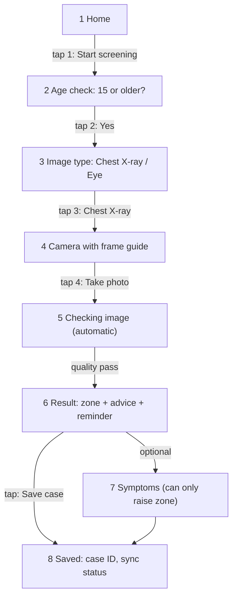
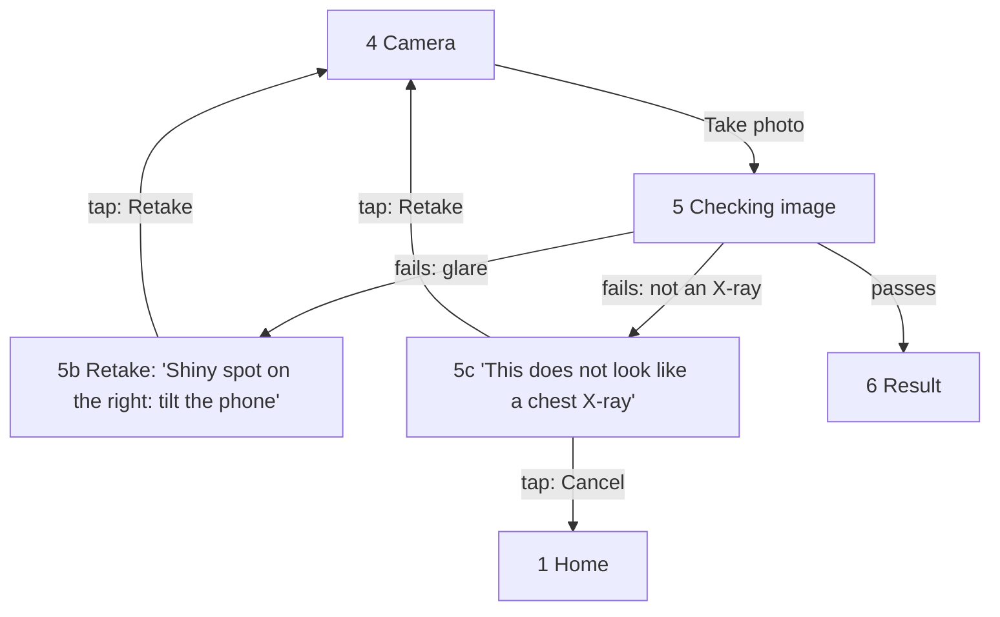
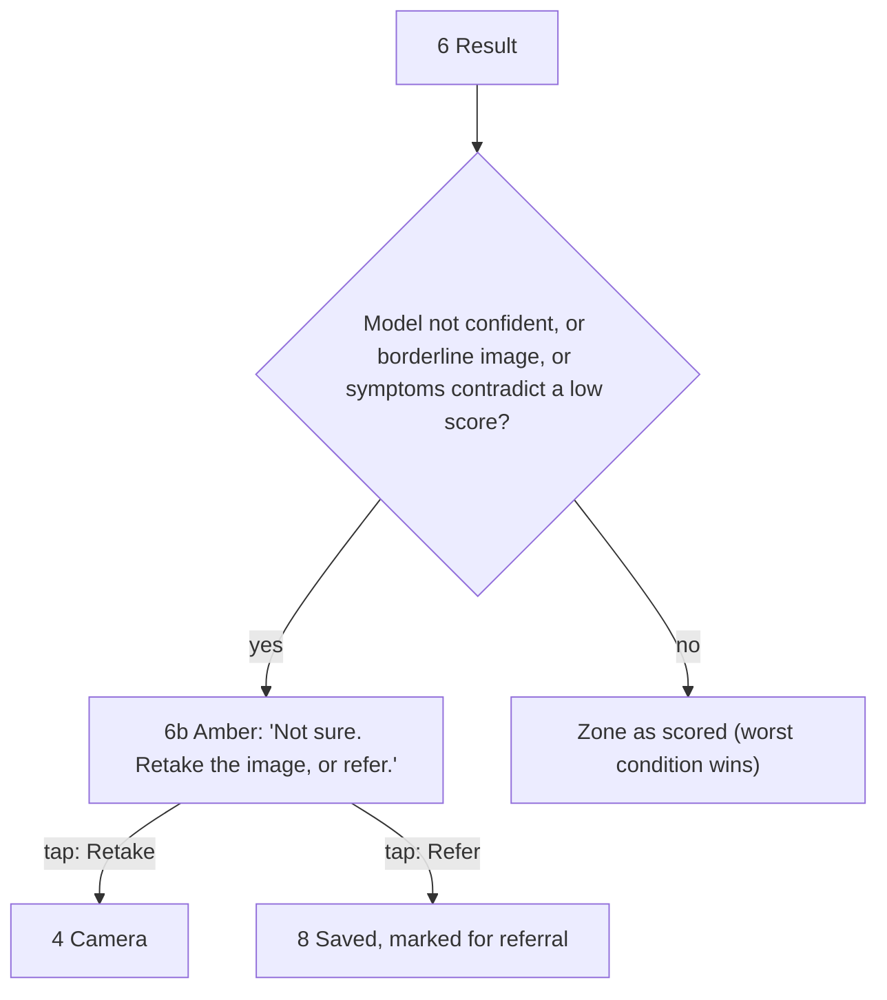

# User journeys (E8-01)

**Status:** Draft, built from TRD 6.3 (J1 to J3), with rules from TRD 7.2, 7.3 and FR-01 to FR-07. Check each step against the interviews and mark changes. Screens are numbered as in [low-fi-flows.md](low-fi-flows.md).

**Persona (TRD 6.1, 6.2):** a community health nurse at a district facility, trained to take images but not to read them. Busy and often interrupted. Uses a low-end Android phone with a cracked screen and little storage. The internet is off for days at a time.

## J1. Screening, happy path (TRD 6.3 J1)

**Goal:** a fast, clear "refer or not" signal, offline, in under 90 seconds (TRD 3.4).

| Step | What the worker does | What the app does | Rule |
|------|----------------------|-------------------|------|
| 1 | Opens the app, taps **Start screening** | Opens offline; shows unsynced count | NFR-OFFL-01 |
| 2 | Confirms the person is 15 or older | No result path for under 15 | TRD 3.3, H5 |
| 3 | Picks **Chest X-ray** | Loads the cached model in a worker | ADR-2 |
| 4 | Frames the film and taps **Take photo** | Removes EXIF and GPS; creates the case record now | FR-01, FR-07 |
| 5 | Waits a few seconds | Quality and modality gate, then inference | FR-02, FR-03, FR-04 |
| 6 | Reads the zone and advice | Colour + icon + text; reminder; model version | FR-05, TRD 7.3 |
| 7 | Optionally ticks symptoms | Can raise the zone, never lower it | FR-05 |
| 8 | Saves | Encrypted on the phone; queued for sync | FR-07, FR-08 |

## J2. Poor image (TRD 6.3 J2)

**Goal:** never show a result for a bad image; tell the worker exactly how to fix it.

| Step | What the app does | Rule |
|------|-------------------|------|
| Fail | Shows **one** reason from the approved list, in plain words, with an icon. **No zone, no score.** | FR-03, TRD 7.2 |
| Retake | Returns to the camera with the frame guide; the case record is kept | FR-07 |
| Wrong type | Refuses non-medical or wrong-type images | FR-02, H3 |

## J3. Unsure result (TRD 6.3 J3)

**Goal:** uncertainty leads to a retake or a referral, never to reassurance.

| Trigger | Result | Rule |
|---------|--------|------|
| Score between the two thresholds | Amber | TRD 7.2 |
| Image borderline on quality | Amber | TRD 7.2 |
| Symptoms ticked after a green result | At least amber | TRD 7.2, FR-05 |
| One condition red, another green | Red (worst wins) | TRD 7.2 |

## Not drawn here

J4 (offline for days) and J5 (clinician review) from TRD 6.3 belong to E9-02 and E10-01. Their screens are listed in [low-fi-flows.md](low-fi-flows.md) so that navigation stays consistent.

## Questions for the interviews

- Is "Start screening" the words health workers would use? Would "New patient" or "New scan" be clearer?
- Is the age check better as one question ("15 or older?") or as age bands (FR-07 stores an age band)?
- Do workers screen one person at a time, or batch photos and read results later?
